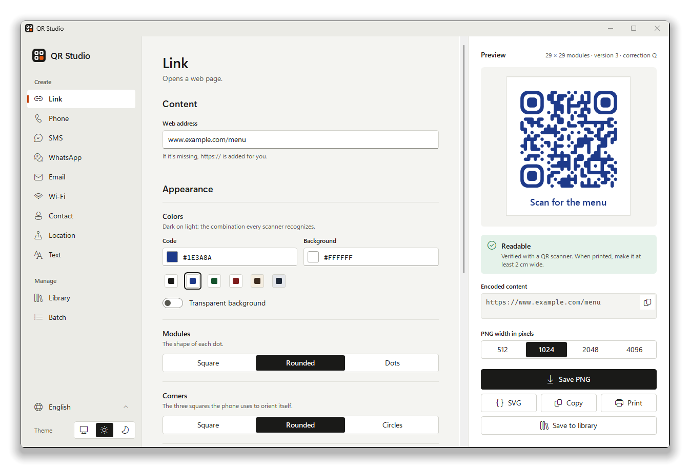
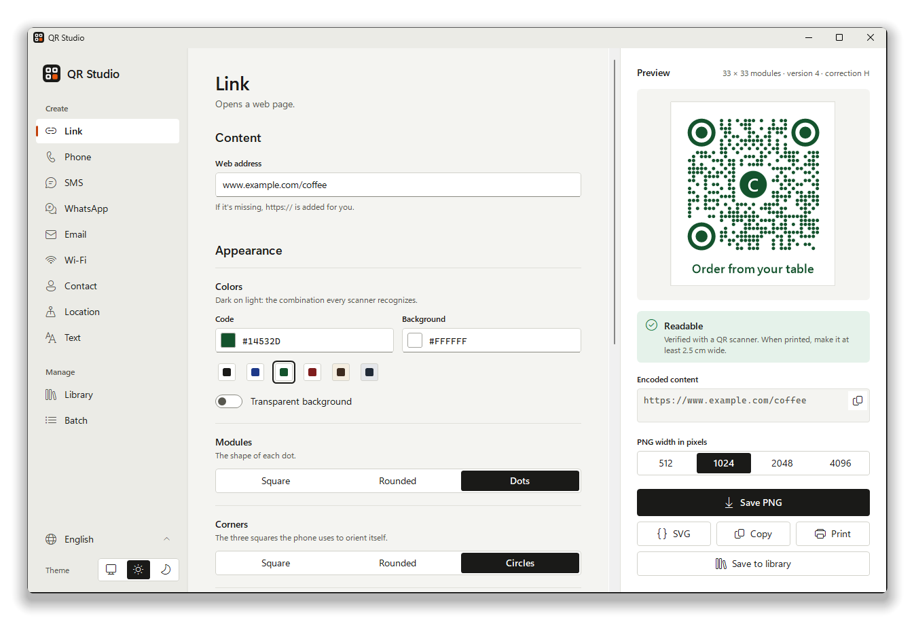
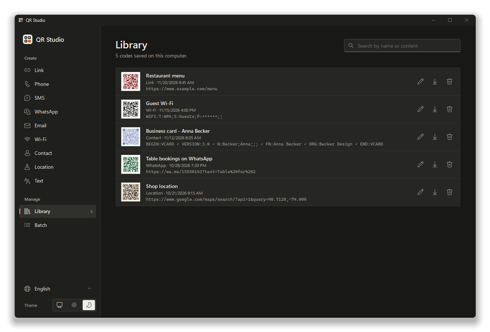

  <picture>
    <source media="(prefers-color-scheme: dark)" srcset="assets/logo-dark.png">
    
  </picture>

<h1 align="center">QR Studio</h1>

  QR codes for links, phone numbers, Wi-Fi, contacts and more. 
  A Windows app that works offline and test-scans every code before you save it.

  
  
  
  

  <a href="https://github.com/CutriZ/QR-Studio/releases/latest"><b>Download for Windows</b></a>
  &nbsp;·&nbsp;
  <a href="#download">Setup or portable?</a>

 

<picture>
  <source media="(prefers-color-scheme: dark)" srcset="assets/generator-dark.png">
  
</picture>

## How it works

Pick what the code should do, fill in the fields, and the preview updates as you type. Before you export anything, QR Studio reads the code back with a QR decoder at three different resolutions. If the scan fails, or the colors are too close for a printed code to work, it says what went wrong and what to change. When the code passes, it tells you the smallest size you can print it at.

## Nine kinds of code

| Type | What happens when someone scans it |
| --- | --- |
| Link | Opens a web page |
| Phone | Starts a call to the number |
| SMS | Opens a text message with the recipient and message filled in |
| WhatsApp | Opens a chat with the number, optionally with a message ready to send |
| Email | Opens a new email with recipient, subject and body |
| Wi-Fi | Joins the network without typing the password (WPA/WPA2, WPA3, WEP or open) |
| Contact | Adds a business card (vCard) to the address book |
| Location | Opens a point on the map, as a Google Maps link or a `geo:` URI |
| Text | Shows plain text |

Every field is checked as you go. A phone number with letters in it or an email without a domain gets flagged next to the field, before it ends up in a code.

## Colors, shapes and logo

- Any color for the code and the background, six ready-made pairs, or a transparent background.
- Square, rounded or dot modules, and square, rounded or circular corners.
- Your logo in the center. Error correction switches to level H on its own to make up for the covered area.
- A caption under the code, such as "Scan for the menu", included in every export.
- Error correction from L to H and a margin from 0 to 10 modules.

## Export

- PNG at 512, 1024, 2048 or 4096 pixels
- SVG for print shops and large formats
- Copy to the clipboard and paste into Word, PowerPoint or an email
- Print at 7 cm (2.75 in)

## Library and batch

Save a code to the library and reopen it later to change the content or the style. Search works on names and content. Wi-Fi passwords are masked in the list.

Batch mode turns a list into files: one PNG or SVG per line. Paste the lines, import a `.txt` or `.csv`, or paste two columns from Excel to choose the file names. Existing files are never overwritten.

## Six languages

English, Italiano, Español, Français, Deutsch and Português (Brasil). QR Studio starts in your Windows language and you can switch from the sidebar at any time, without restarting or losing what you typed. It also has a light and a dark theme that follow Windows.

## Your data stays on your computer

There is no account, no ads, no telemetry, and no internet connection needed. The codes are static: the content is stored in the image itself, with no redirect service in between, so they never expire and QR Studio never sees who scans them.

Settings and the library are saved in `%AppData%\QR Studio`.

## Download

Get both files from the [latest release](https://github.com/CutriZ/QR-Studio/releases/latest).

| File | Use it if |
| --- | --- |
| `QRStudio-Setup-1.1.0.exe` | You want QR Studio installed, with a Start menu shortcut and an uninstaller. No administrator rights needed. |
| `QRStudio-Portable-1.1.0.exe` | You want a single file that runs without installing, from a folder or a USB stick. |

Both include everything they need, so there is no .NET or other runtime to install. They run on Windows 10 (version 1809 or later) and Windows 11, 64-bit.

**"Windows protected your PC"**: QR Studio is not code-signed yet, so SmartScreen may show this warning the first time you run it. Click **More info**, then **Run anyway**. Each release lists the SHA-256 checksum of its files if you want to verify your download.

## Keyboard shortcuts

| Keys | Action |
| --- | --- |
| <kbd>Ctrl</kbd> + <kbd>S</kbd> | Save PNG |
| <kbd>Ctrl</kbd> + <kbd>Shift</kbd> + <kbd>S</kbd> | Save SVG |
| <kbd>Ctrl</kbd> + <kbd>Shift</kbd> + <kbd>C</kbd> | Copy the image |
| <kbd>Ctrl</kbd> + <kbd>P</kbd> | Print |
| <kbd>Ctrl</kbd> + <kbd>1</kbd> … <kbd>9</kbd> | Switch code type |
| <kbd>Ctrl</kbd> + <kbd>F</kbd> | Search the library |

## Feedback

Found a bug or missing a code type? [Open an issue](https://github.com/CutriZ/QR-Studio/issues).

 

  Made by DFN Development · © 2026

